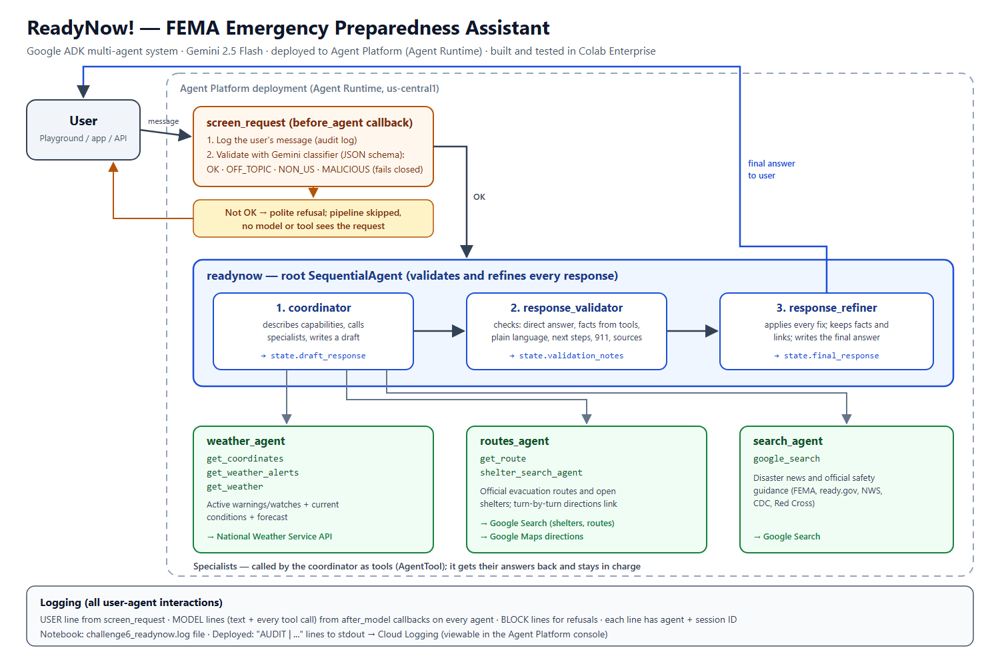

# adk-nmp

# Google ADK Bootcamp: Neal Petro

Contained herein are the solutions to the six Google Agent Development Kit challenges. Each notebook builds on the previous one, starting with one weather agent in Challenge 1 and ending with a deployed multi-agent emergency assistant in Challenge 6. Every notebook was run in Colab Enterprise, and its outputs, including the test results are saved in the file.

**Stack:** Google ADK 2.7.0 · Gemini 2.5 Flash · Agent Platform (Agent Runtime) · Colab Enterprise · National Weather Service API · Google Search

## Challenges

| # | Challenge | What is built | Tests | Files |
|---|---|---|---|---|
| 1 | Real-time weather agent | Agent with two tools: a lookup table of US city coordinates and a live National Weather Service forecast (`api.weather.gov`). Can also run on a third-party model (Claude) | Tools pass for 5 cities; Gemini agent 3/3 | [notebook](Challenge-1-weather-agent.ipynb) |
| 2 | Callbacks | Callbacks that log each user prompt and each model response to a file, plus input validation: a Gemini classifier labels each message OK, NON_US or MALICIOUS, and anything not OK is refused before the model sees it. If the check fails, the message is blocked | Validator 6/6; agent 3/3 | [notebook](Challenge-2-callbacks.ipynb) |
| 3 | Multi-agent system | Root agent that hands weather questions to a weather sub-agent and calls a Google Search agent as a tool. The weather agent hands questions back to the root when they aren't about weather | 4/4, including the hand-back | [notebook](Challenge-3-multi-agents.ipynb) |
| 4 | Agent workflow | Greeter, then an answer team: search, then a critique and refine loop that repeats until the critic approves (`exit_loop`). Each step passes its work to the next through session state | 4/4; session state shows draft, then critique, then refined answer | [notebook](Challenge-4-agent-workflow.ipynb) |
| 5 | Deploying agents | The Challenge 4 system deployed to Agent Platform with `agent_engines.create()`. The same tests run locally and against the deployed agent | Local 4/4; deployed 4/4 | [notebook](Challenge-5-agent-deploy.ipynb) · [screenshots](Challenge-5-agent-deploy-screenshots.pdf) |
| 6 | **Case study: ReadyNow!** | FEMA emergency preparedness assistant, deployed to Agent Platform (details below) | Validator 10/10; local 6/6; **deployed 6/6** | [notebook](Challenge-6-ReadyNow.ipynb) · [architecture](ReadyNow-architecture.png) · [screenshots](Challenge%206%20-%20ReadyNow!%20Agent%20Platform%20screenshots.pdf) |

## Case study: ReadyNow!

| Requirement | How it's met |
|---|---|
| Root agent that describes what it can do and coordinates | `readynow` is a SequentialAgent. Its first step, `coordinator`, explains its capabilities and calls the specialist agents |
| Weather, internet search, routes and question-answering agents | `weather_agent`: NWS forecast and **active alerts** `routes_agent`: official evacuation routes and shelters, plus a Google Maps directions link `search_agent`: disaster news and FEMA / ready.gov guidance |
| Sequential workflow that validates and refines responses | `coordinator` writes a draft, `response_validator` checks it against a checklist (direct answer, facts from tools, plain language, next steps, 911 line, sources), and `response_refiner` writes the final answer. Each step passes its work to the next through session state |
| Callbacks that log all user–agent interactions | Every log line has the agent name and session ID: `USER` for each message, `MODEL` for each response or tool call, `BLOCK` for each refusal. Locally they go to a log file; deployed, to Cloud Logging |
| User input validation | A callback on the root agent sends each message to a Gemini classifier, which labels it OK, OFF_TOPIC, NON_US or MALICIOUS. Anything other than OK is refused before any agent runs, and if the check itself fails, the message is blocked |
| Deployed to Agent Platform and tested | The same 6 tests run locally and against the deployed agent. The screenshots show the deployed agent in the Playground, its traces, and its AUDIT log lines |

## Notes

- **Deployment fixes.** Four problems came up when deploying, each with a fix:
  - Pin the cloud's ADK version to match the notebook's.
  - Don't reference classes defined in the notebook.
  - Create API clients inside functions, not at the top of a cell.
  - Deploy freshly built agents, not ones that already ran the local tests.
- **Claude in Challenge 1.** The code supports Claude on Vertex AI, but Claude returned 404 in this lab project's region, so it's documented as skipped.
- **If a notebook won't display on GitHub,** open it through [nbviewer](https://nbviewer.org/github/nealpetro/adk-nmp/tree/main/).
